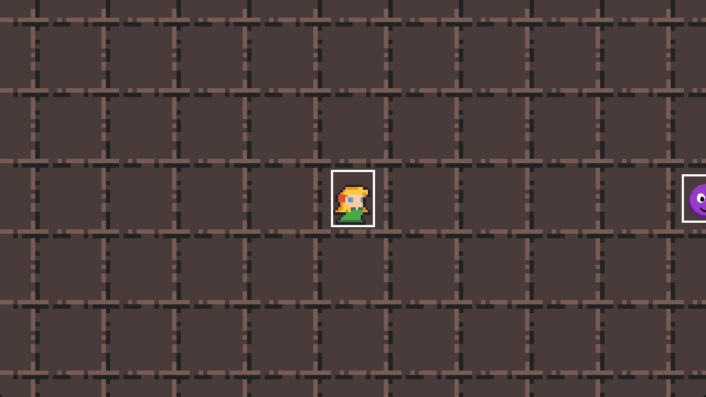

# Roguelike на собственном движке (XYZ School, блок 4)

2D-рогалик на C++ и SFML 2.5.1 поверх компонентного движка `XYZEngine`, который пишется по ходу курса.
Репозиторий ведётся по домашним заданиям блока «Основы проектной разработки игр» и дипломному проекту.



## Структура

| Проект | Что это |
|---|---|
| `XYZEngine` | статическая библиотека движка: `GameWorld`, `GameObject`, компоненты (`TransformComponent`, `SpriteRendererComponent`, `CameraComponent`, `InputComponent`, `RigidbodyComponent`, `SpriteColliderComponent`, `MovementComponent`, `SeekerComponent`, `AudioComponent`, `MusicComponent`, …), системы (`RenderSystem`, `PhysicsSystem`, `ResourceSystem`) |
| `XYZRoguelike` | сама игра: `GameMain.cpp`, сцена `DeveloperLevel`, контейнеры `Player`, `Enemy`, `Wall`, `Floor`, `Arena`, `Music`, настройки в `GameSettings.h` |
| `EngineTest` | unit-тесты движка на Google Test |
| `SFML` | библиотека SFML, подключается статически |

## Домашнее задание №10 — музыка, враг и стены

- **Звук в движке.** `ResourceSystem` научился загружать звуки (`LoadSound`/`GetSound`) и регистрировать музыкальные треки (`RegisterMusic`/`GetMusicPath`). `AudioComponent` проигрывает короткие звуки из памяти, `MusicComponent` стримит трек с диска. В движке только методы воспроизведения, конкретный файл выбирает игра.
- **Музыка.** Объект `Music` создаётся при старте уровня, включает трек `Resources/Music/theme.wav` и зацикливает его.
- **Игрок.** `MovementComponent` двигает объект по осям `InputComponent` (WASD), `SpriteMovementAnimationComponent` листает кадры карты текстур во время движения и разворачивает спрайт по направлению.
- **Враг.** `SeekerComponent` (движок) получает цель-трансформ, радиус обнаружения и скорость: пока игрок внутри радиуса — враг бежит к нему, вышел — враг останавливается. Контейнер `Enemy` собирает спрайт, твёрдое тело, коллайдер и этот компонент; цель — трансформ игрока.
- **Стены и пол.** `Arena` расставляет тайлы пола по сетке (без наложений) и кольцо стен по периметру. Пол создаётся раньше стен, поэтому рисуется под ними. `Wall` — кинематическое тело с коллайдером: физика выталкивает из него игрока и врага, а сама стена не сдвигается.

## Сборка и запуск

1. Открыть `Game.sln` в Visual Studio 2022 (toolset v143, C++17), собрать `XYZRoguelike` (x64).
2. Запускать из папки `XYZRoguelike/` — там лежат `Resources/`.
3. Управление: WASD — движение, закрыть окно — выход.

```
msbuild Game.sln /t:XYZRoguelike /p:Configuration=Release /p:Platform=x64
```
