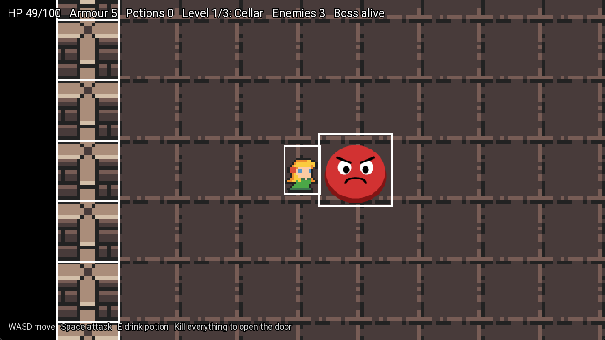
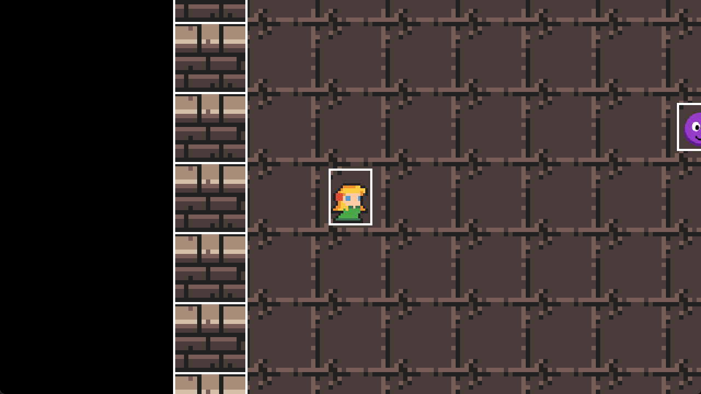

# XYZ Roguelike

2D-рогалик с видом сверху на C++ и SFML 2.5.1 поверх собственного компонентного движка `XYZEngine`.
Проект блока «Основы проектной разработки игр» и дипломная работа курса XYZ School «C++ для разработки игр 1.0»
(направление — программист игровой логики).



Три локации, в каждой — слизни, босс у двери и зелья на полу. Зачистил комнату и убил босса — дверь открылась, за ней следующая локация. После третьей — экран победы.

## Запуск

Готовая сборка лежит в [Releases](../../releases): распакуй архив и запусти `XYZRoguelike.exe` (рядом должны быть `openal32.dll` и папка `Resources`).

| Клавиша | Действие |
|---|---|
| W A S D | движение |
| Пробел | удар по ближайшему врагу в радиусе |
| E | выпить зелье (+40 HP) |
| R | начать заново на экране победы |
| F2 | *(только Debug-сборка)* принудительно открыть дверь — для демонстрации переходов |

## Сборка из исходников

1. Открыть `Game.sln` в Visual Studio 2022 (toolset v143, C++17).
2. Собрать проект `XYZRoguelike` (x64, Debug или Release). SFML лежит в репозитории и линкуется статически, движок `XYZEngine` — статическая библиотека, собирается как зависимость.
3. Запускать из папки `XYZRoguelike/` — там лежат `Resources/`; `log.txt` пишется туда же.

```
msbuild Game.sln /t:XYZRoguelike /p:Configuration=Release /p:Platform=x64
```

## Структура

| Проект | Что это |
|---|---|
| `XYZEngine` | движок: `GameWorld`, `GameObject`, компоненты и системы (см. ниже) |
| `XYZRoguelike` | игра: `RoguelikeGame` (поток локаций), `GameLevel` (одна локация), контейнеры `Player`, `Enemy`, `Boss`, `Wall`, `Floor`, `Door`, `Potion`, `Hud`, `Music`, `Arena`; настройки в `GameSettings.h` |
| `EngineTest` | unit-тесты движка (Google Test) |
| `SFML` | библиотека SFML 2.5.1 |
| `docs/` | [дизайн-документ](docs/DESIGN.md), скриншоты |

Компоненты движка: `TransformComponent`, `SpriteRendererComponent`, `CameraComponent`, `InputComponent`, `MovementComponent`, `SpriteMovementAnimationComponent`, `RigidbodyComponent`, `SpriteColliderComponent`, `SeekerComponent`, `HealthComponent`, `AttackComponent`, `InventoryComponent`, `AudioComponent`, `MusicComponent`, `ScreenTextComponent`, `KeyActionComponent`.
Системы: `RenderSystem`, `PhysicsSystem`, `ResourceSystem`, `Logger`.

## Дипломный проект — что добавлено



- **Локации и переходы (лёгкий уровень).** `LevelDefinition` описывает локацию: размер, число врагов и зелий, тайлы, сила босса. `GameLevel` строит `Arena` с проёмом под дверь, расставляет врагов, босса и зелья. `RoguelikeGame` держит список из трёх локаций и переключает их в конце кадра через `GameWorld::RunLater`. Дверь закрыта — это обычная стена, открыта — триггер: вошёл игрок, грузится следующая локация.
- **Босс на каждой карте (средний уровень).** `Boss` преследует игрока (`SeekerComponent`), бьёт сильнее обычного врага и раз в четыре секунды делает рывок через комнату (`ChargeComponent`). Здоровье босса растёт от локации к локации. Пока босс жив, дверь не откроется.
- **Инвентарь и зелья (часть сложного уровня).** `InventoryComponent` в движке считает предметы. `Potion` лежит на полу как триггер, при касании попадает в инвентарь; по E `PlayerControllerComponent` тратит зелье и лечит на 40 HP.
- **HUD и экран победы.** `ScreenTextComponent` рисует текст в координатах окна поверх мира. HUD показывает HP, броню, зелья, локацию, число врагов и состояние босса. После третьей двери — экран «YOU WON» со счётчиком смертей и перезапуском по R.
- **Исправление движка по дороге.** Коллайдеры читали позицию спрайта с задержкой в кадр, и свежесозданные объекты сталкивались в начале координат — игрока выкидывало за стену на новой локации. Теперь коллайдер синхронизирует спрайт с трансформом перед чтением границ.

Подробности, оценка в сторипоинтах и таймлайн — в [docs/DESIGN.md](docs/DESIGN.md).

### Ветки и pull requests

| Ветка | PR | Что внутри |
|---|---|---|
| `feature/level-transitions` | #1 | три локации, дверь, переходы, фикс коллайдеров |
| `feature/boss` | #2 | босс с рывком, дверь ждёт смерти босса |
| `feature/inventory-hud` | #3 | инвентарь, зелья, HUD, экран победы |
| `docs/diploma` | #4 | README, дизайн-документ, скриншоты |

Теги на `main`: `hw10`, `hw11`, `diploma`.

## Домашнее задание №10 — музыка, враг и стены

- **Звук в движке.** `ResourceSystem` загружает звуки (`LoadSound`/`GetSound`) и регистрирует музыкальные треки (`RegisterMusic`/`GetMusicPath`). `AudioComponent` проигрывает короткие звуки из памяти, `MusicComponent` стримит трек с диска. В движке только методы воспроизведения, конкретный файл выбирает игра.
- **Музыка.** Объект `Music` создаётся при старте уровня, включает трек `Resources/Music/theme.wav` и зацикливает его.
- **Игрок.** `MovementComponent` двигает объект по осям `InputComponent` (WASD), `SpriteMovementAnimationComponent` листает кадры карты текстур во время движения и разворачивает спрайт по направлению.
- **Враг.** `SeekerComponent` (движок) получает цель-трансформ, радиус обнаружения и скорость: пока игрок внутри радиуса — враг бежит к нему, вышел — враг останавливается. Контейнер `Enemy` собирает спрайт, твёрдое тело, коллайдер и этот компонент.
- **Стены и пол.** `Arena` расставляет тайлы пола по сетке (без наложений) и кольцо стен по периметру. Пол создаётся раньше стен, поэтому рисуется под ними. `Wall` — кинематическое тело с коллайдером: физика выталкивает из него игрока и врага, а сама стена не сдвигается.


## Домашнее задание №11 — логирование, ассерты, здоровье и атака

- **Логгер.** `Logger` (движок) — единая точка входа с уровнями DEBUG / INFO / WARNING / ERROR и приёмниками `ConsoleSink` и `FileSink` (`log.txt` рядом с exe). Макросы `LOG_DEBUG("x=" << x)` и т.д. Все `std::cout` в движке заменены на логгер: создание и удаление объектов и коллайдеров — DEBUG, загрузка ресурсов, старт уровня, бой — INFO, подозрительные параметры и низкое здоровье — WARNING, отсутствующие ресурсы и неверное использование компонентов — ERROR.
- **Ассерты и исключения.** `ResourceSystem::LoadTextureMap` бросает `std::invalid_argument` при нулевом размере элемента, `RenderSystem::GetMainWindow` — `std::runtime_error` без окна, `Arena` — при неположительном размере; `GameMain` ловит их и пишет в лог. Ассерты стоят на нарушениях контракта (null-компонент, неположительное здоровье). Отсутствующая текстура не роняет игру: `ResourceSystem` пишет ERROR и подставляет ярко-розовую заглушку. Для демонстрации игра специально пытается загрузить несуществующий `Textures/Decor.png`.
- **Здоровье и броня.** `HealthComponent` (движок): максимум HP, броня вычитается из каждого удара (минимум 1 урона), колбэк смерти, WARNING при HP ниже 25 %. Игрок: 100 HP / 5 брони, враг: 50 HP / 2 брони, босс: 120–300 HP / 6 брони.
- **Атака.** `AttackComponent` (движок): урон, дальность, перезарядка, `TryAttack(HealthComponent*)` и авто-режим `SetAutoTarget`. Враг и босс бьют игрока автоматически, когда догнали его. Игрок бьёт ближайшего врага в радиусе по пробелу. Убитый враг удаляется из мира в конце кадра, смерть игрока перезапускает локацию.

Фрагмент `log.txt`:

```
12:50:54.269 [INFO] 'Boss' attacks 'Player' for 22
12:50:54.270 [INFO] 'Player' takes 17 damage from Boss (22 minus 5 armour), health 83/100
12:50:54.631 [INFO] 'Player' attacks 'Boss' for 20
12:50:54.631 [INFO] 'Boss' takes 14 damage from Player (20 minus 6 armour), health 106/120
```
